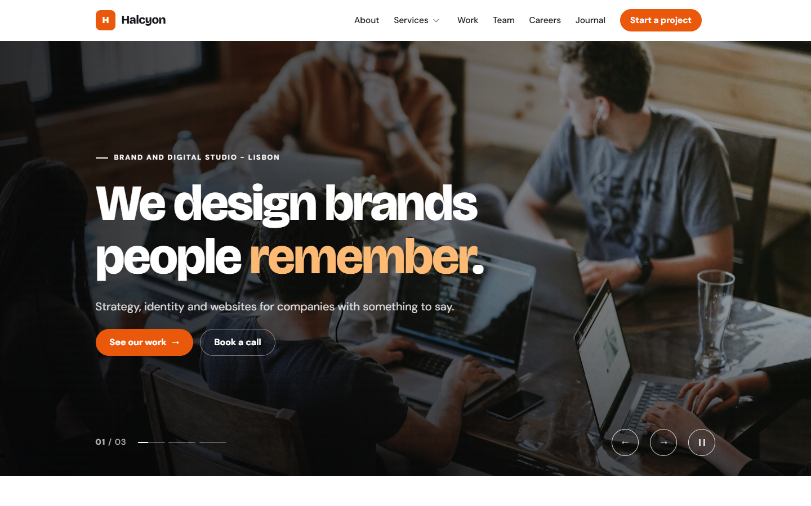
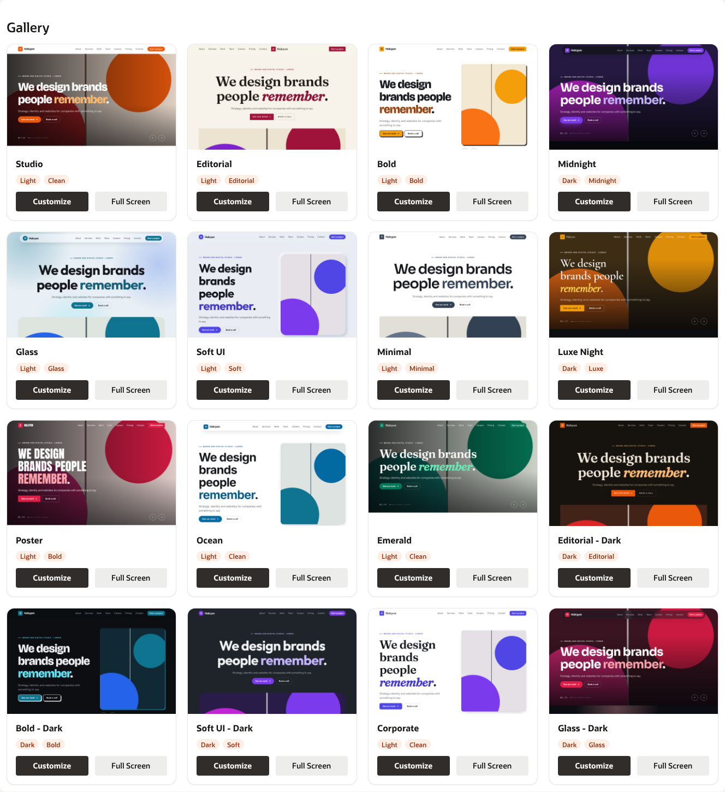
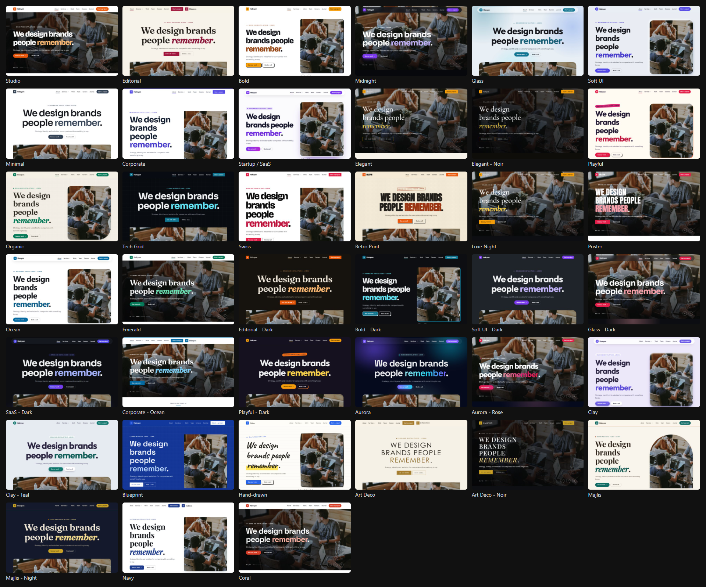
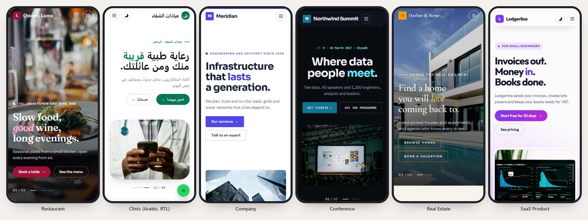

# Website Studio for Oracle APEX

[](https://apex.oracle.com) [](LICENSE)

One-page websites built in Oracle APEX. Website Studio gives you a page template, a section template, a menu template and **23 report templates**. They cover:

- a hero slider, services, numbers that count up, team, testimonials, clients, pricing, timeline and process
- careers, FAQ, portfolio, links and contact details
- news, products and menus, a photo gallery with a lightbox, image-and-text rows, events, opening hours, comparison tables, videos and maps

**Every list comes from a SQL query.** You get 15 designs, 10 accent colours, light and dark, and 7 typefaces (one of them Arabic). Pages work right to left. **8 starter websites** are ready to copy. Every look is a template option, so there is nothing to code.



Website Studio is a small APEX application. It has:

- a **Gallery** of starter websites and ready-made looks
- a **Designer** that previews every option live on phone, tablet and desktop and gives you the options as APEXlang
- the **starter websites** themselves
- the templates, which you copy into your own application

| Template | Type | What it is |
|---|---|---|
| **Modern One Page** | Page | The website: a header with the menu, a hero, the sections and a footer |
| **Modern Section** | Region | One band of the page. The region title is the heading and the Static ID is the menu anchor |
| **Website - Menu** | List | The header menu: static or SQL lists, drop-downs for child entries, and a phone menu |
| **Website - Hero, Numbers, Services, Team, Testimonials, Logos, Pricing, Timeline, Process, FAQ, Careers, Portfolio, Links, Contact Details, News, Products, Photo Gallery, Image and Text, Events, Opening Hours, Comparison, Video, Map** | Classic Report | Each one turns the rows of a SQL query into a section |

## Starter websites

| Page | Alias | Website | Shows |
|---|---|---|---|
| 10 | `WEBSITE` | Halcyon, a design studio | Every classic section: slider, services, portfolio, team, careers, pricing, FAQ |
| 11 | `COMPANY` | Meridian, an engineering company | Image-and-text rows, news, leadership, careers |
| 12 | `RESTAURANT` | Osteria Lume | **SQL menu list**, food menu with filter, photo gallery, events, opening hours, map, booking form |
| 13 | `CLINIC` | Al Shifa clinics, **in Arabic, right to left** | Arabic typeface, side drawer menu, doctors, opening hours, WhatsApp button, light/dark toggle |
| 14 | `REAL-ESTATE` | Harbor & Stone | Listings with filter, agents, full-width map, overlay phone menu |
| 15 | `CONFERENCE` | Northwind Data Summit | Agenda with filter, speakers, video, tickets, venue, sponsors |
| 16 | `PORTFOLIO` | Lina Haddad, a designer | Editorial portfolio, experience timeline |
| 17 | `SAAS` | Ledgerline | Bento features, comparison table, pricing, light/dark toggle |

Each website has a menu with child entries, an external link and a button, plus a contact form with spam protection. It also has meta and Open Graph tags and a preloaded hero photo.



## Designs

| Design | Look |
|---|---|
| Clean | White pages, soft shadows and rounded cards |
| Editorial | Paper colours, serif headlines, fine rules and square corners |
| Bold | Neo-brutalist: ink outlines and hard offset shadows |
| Soft UI | Neumorphic: cards rise out of a soft grey page |
| Glass | Frosted cards over a colour wash in the accent colours |
| Midnight | Always dark, with glowing buttons |
| Minimal | No cards: hairlines, large type and white space |
| Corporate | Structured and image-led: navy and grey, square buttons, a ruled heading |
| Startup / SaaS | A soft gradient mesh, framed product shots and glowing cards |
| Elegant / Luxury | Cream or black, thin serif headings, gold details |
| Playful | Rounded and bright: sticker labels, tinted cards and offset shadows |
| Organic / Nature | Earthy colours, soft organic shapes and a paper texture |
| Tech Grid | Dark, fine grid lines, monospace details and sharp corners |
| Swiss | A strict grid, big sans-serif type, red details and hairline rules |
| Retro Print | Newsprint colours, ink borders, halftone dots and stamped labels |

Every design takes 10 **accent colours** (or your theme colour) and **light / dark / follow the device**. You can also set:

- **Typefaces**: System, Grotesk, Serif, Luxe, Tech, Poster, Friendly and Arabic. All but System load from Google Fonts.
- **Header**: classic, centred logo, a floating pill, or transparent over the hero. It can be sticky and can show a scroll progress bar. You can add a **light/dark toggle** and a **WhatsApp button**.
- **Menu**: alignment, how many entries before **More**, and the phone menu (drop-down, full-screen overlay or side drawer). The last entry can show as a button.
- **Sections**: background, spacing, heading position and width.
- **Report layouts**:
  - Hero: slider, split, centred or full bleed; large, full-screen or medium height; normal, light or strong overlay; fade or slide; slow zoom. It can show a background video.
  - Services: cards, rows, bento or icons. Testimonials: carousel, wall or spotlight. Team: portraits, round photos or a list.
  - Portfolio: grid, editorial or large. Logos: marquee, grid or row.
  - News: cards, featured or list. Products: cards, menu or compact. Photos: grid, masonry or a strip.
  - Filter buttons for portfolio, careers, products and events.
- **Placeholder images**: what a row without a photo shows (soft gradient, subtle pattern, duotone shapes or plain colour). People show their initials.



<details><summary>On a phone</summary>


</details>

## Install

Website Studio is an APEX 26.1 application in [APEXlang](apexlang/). There are no database objects.

1. Import it with SQLcl 26.1: `apex import -input apexlang` (in this repository's root), or
2. once a release export is published, download `website-studio.sql` and use **App Builder > Import** with any application ID.

Run it. Every page is public.

**Photos.** The starter websites expect their photos in Static Application Files under `website-studio/img/`. To download them, run this on a computer with internet access:

```bash
node tools/fetch-photos.mjs
```

It uses free [Unsplash](https://unsplash.com/license) photos, crops and compresses them on the Unsplash CDN within a 5 MB budget, and records every source in [docs/CREDITS.md](docs/CREDITS.md). Then run `cd apexlang && node _src/build.mjs` and import again. Without the photos, the websites show their placeholder images.

The templates, option groups and pages are built from [`apexlang/_src`](apexlang/_src). Never edit the generated `.apx` files; change the sources and run:

```bash
cd apexlang
```

```bash
node _src/build.mjs
```

```bash
node _src/pages.mjs
```

```bash
node _src/studio-pages.mjs
```

- `_src/build.mjs` builds the templates and static files.
- `_src/pages.mjs` builds the websites and `lists.apx`.
- `_src/studio-pages.mjs` builds the Gallery, Designer and How to Use.

For checks and screenshots, see [`qa/`](qa/README.md).

## Use it in your application

The quickest way: open a starter website in the Designer, pick a look, then copy the page into your application (**Create > Page as Copy**). The longer way:

1. **Copy the templates.** In *your* application, go to **Shared Components > Templates > Create > As a Copy of an Existing Template**. From **Website Studio**, copy:
   - **Modern One Page** (page template)
   - **Modern Section** (region template)
   - **Website - Menu** (list template)
   - the **Website - ...** report templates you need

   Tick *Subscribe* to receive later updates.
2. **Upload the static files.** The templates load `website-studio/website.css` and `website-studio/website.js` from **Shared Components > Static Application Files**, and the copy does not bring them along. Upload them from [`apexlang/shared-components/static-files/website-studio`](apexlang/shared-components/static-files/website-studio) into a directory named `website-studio`.
3. **Build the page.** Create a blank page with **Page Template = Modern One Page**. Make it public if visitors should not sign in. Add the **Template Options** from the Designer:

```
appearance {
    pageTemplate: @modern-one-page
    templateOptions: [
        #DEFAULT#
        ws-Design--corporate
        ws-Accent--indigo
        ws-Font--tech
    ]
}
```

4. **Add sections.** Create regions with the **Modern Section** template in the *Body* slot, each with a Static ID (its menu anchor). For a list of things, make the region a **Classic Report**, return the template's columns, and pick the report template. Add a `SORT_ORDER` column with *Sorting > Default Sequence* 1, because APEX does not keep the query's order:

```sql
select name, role, photo_url as image_url, name as image_alt, linkedin_url as link, display_order as sort_order
  from team_members
```

5. **Add the menu.** Create a List in **Shared Components > Lists**: entries such as `#services` scroll to a section, and child entries become drop-downs. Then add a **List** region in the **Menu** slot with region template *Blank with Attributes* and list template **Website - Menu**. A list can also be a SQL query (the restaurant starter shows how). Without a list region, the menu is built from the sections.

| Report template | Columns (all optional) |
|---|---|
| Website - Hero | `TITLE` `SUBTITLE` `TEXT` `IMAGE_URL` `IMAGE_FILE` `IMAGE_ALT` `IMAGE_POSITION` `VIDEO_URL` `BUTTON_LABEL` `BUTTON_LINK` `BUTTON2_LABEL` `BUTTON2_LINK`, one row per slide |
| Website - Numbers | `VALUE` `PREFIX` `SUFFIX` `LABEL` `TEXT` |
| Website - Services | `ICON` `TITLE` `TEXT` `LINK` `LINK_LABEL` |
| Website - Team | `NAME` `ROLE` `IMAGE_*` `BIO` `LINK` `LINK_ICON` |
| Website - Testimonials | `QUOTE` `NAME` `ROLE` `IMAGE_*` `RATING` (0 to 5) |
| Website - Logos | `NAME` `IMAGE_URL` `IMAGE_FILE` `LINK` |
| Website - Pricing | `NAME` `PRICE` `PERIOD` `DESCRIPTION` `FEATURES` (one per line, or `\|` separated) `BUTTON_LABEL` `BUTTON_LINK` `IS_FEATURED` (Y/N) `BADGE` |
| Website - Timeline | `YEAR` `TITLE` `TEXT` |
| Website - Process | `TITLE` `TEXT` `DURATION` |
| Website - FAQ | `QUESTION` `ANSWER` |
| Website - Careers | `TITLE` `TEAM` `LOCATION` `TYPE` `DESCRIPTION` `APPLY_LINK` `APPLY_LABEL` |
| Website - Portfolio | `TITLE` `CATEGORY` `IMAGE_*` `LINK` `META` |
| Website - Links | `LABEL` `LINK` `ICON`: social icons, footer link columns, link tiles |
| Website - Contact Details | `ICON` `LABEL` `VALUE` `LINK` |
| Website - News | `TITLE` `TEXT` `IMAGE_*` `POST_DATE` `CATEGORY` `LINK` |
| Website - Products | `NAME` `TEXT` `PRICE` `IMAGE_*` `CATEGORY` `BADGE` `LINK`: products, a restaurant menu, property listings |
| Website - Photo Gallery | `IMAGE_*` `TITLE` `CAPTION`: opens in a lightbox (keyboard and swipe) |
| Website - Image and Text | `EYEBROW` `TITLE` `TEXT` `IMAGE_*` `LINK` `LINK_LABEL`: zig-zag rows |
| Website - Events | `EVENT_DATE` `EVENT_TIME` `TITLE` `TEXT` `LOCATION` `SPEAKER` `LINK` `LINK_LABEL` `CATEGORY` |
| Website - Opening Hours | `DAY_NAME` `HOURS` `NOTE` `DAY_NUMBER` (1 = Monday; today is highlighted) |
| Website - Comparison | `FEATURE` `COL1` to `COL4` `IS_HEADER`: `Y`/`N` show as a tick or a dash |
| Website - Video | `VIDEO_URL` (YouTube, Vimeo or a file) `TITLE` `TEXT` `IMAGE_*`: the player loads on click |
| Website - Map | `MAP_URL` (an embed URL) `TITLE` `ADDRESS` `TEXT` `LINK` `LINK_LABEL`: the map loads when it scrolls into view |

`IMAGE_*` stands for the same four columns everywhere:

- `IMAGE_URL`: any https URL
- `IMAGE_FILE`: a Static Application File name, such as `website-studio/img/team-1.jpg`
- `IMAGE_ALT`: what the picture shows
- `IMAGE_POSITION`: the part to keep when cropping, such as `center 30%`

Pictures load as they scroll into view. A picture stored in a BLOB column works through an application process; *How to Use* has the copy-ready code.

6. **The rest.**
   - **Hero:** a Classic Report in the *Hero* slot (Modern Section with Spacing *None*, Width *Full Width*, Heading *Hidden*).
   - **Free text:** Static Content with helper classes (`ws-Eyebrow`, `ws-Lead`, `ws-Split`, `ws-Btn`, `ws-Checks`, `ws-Statement` ...).
   - **Contact form:** ordinary page items in a Modern Section with the CSS class `ws-Contact`. The starters add a hidden honeypot item against spam and show an `apex_mail` example in the process.
   - **Footer and logo:** footer columns go in the *Footer* slot, the copyright in *Footer Bottom*, and a logo in *Logo*.

`*word*` in a title highlights the word.

## Right to left, search engines, speed

- **Arabic and RTL.** The CSS uses logical properties, so a right-to-left page mirrors the menu, sliders, arrows, drawer and floating buttons. The Arabic clinic starter sets `dir="rtl"` from its HTML Header. JavaScript texts are built in for Arabic. For other languages, create the text messages `WEBSITE_STUDIO.MENU`, `.BACK_TO_TOP`, `.ALL`, `.PREVIOUS`, `.NEXT`, `.SLIDE`, `.APPLY`, `.MORE`, `.CLOSE`, `.PLAY`, `.DARK_MODE` and `.MAP`.
- **WhatsApp.** Turn on the *WhatsApp Button* option and set the substitution string `WHATSAPP_NUMBER`: international format, digits only.
- **SEO.** Each starter's *HTML Header* has a meta description and Open Graph tags (`og:title`, `og:description`, `og:image`). Use a full https URL for `og:image` when you can.
- **Speed.** Images load lazily and the first hero photo is preloaded. Videos and maps load on demand. `website.css` is minified (about 20 KB gzip).

## Notes

- Font APEX has no brand icons, so Website Studio draws its own. They are `fa-instagram`, `fa-linkedin`, `fa-x-twitter`, `fa-facebook`, `fa-youtube-play`, `fa-github`, `fa-tiktok`, `fa-dribbble`, `fa-behance`, `fa-pinterest`, `fa-whatsapp` and `fa-threads`.
- A column the query does not return is simply left out, so every column is optional.
- Visitors who prefer reduced motion get no animations. Windows high-contrast mode is respected. The menu, slider, lightbox and accordions work with the keyboard.
- Transparent over Hero needs the Slider or Full Bleed hero. With any other first section, it behaves like Classic.
- Things to check on a live APEX instance are listed in [LIVE_CHECKS.md](LIVE_CHECKS.md).

## Support

Questions, bugs and ideas: [GitHub Issues](https://github.com/HashaamShoukat/apex-website-studio/issues).

[MIT](LICENSE) © 2026 Hashaam Shoukat
